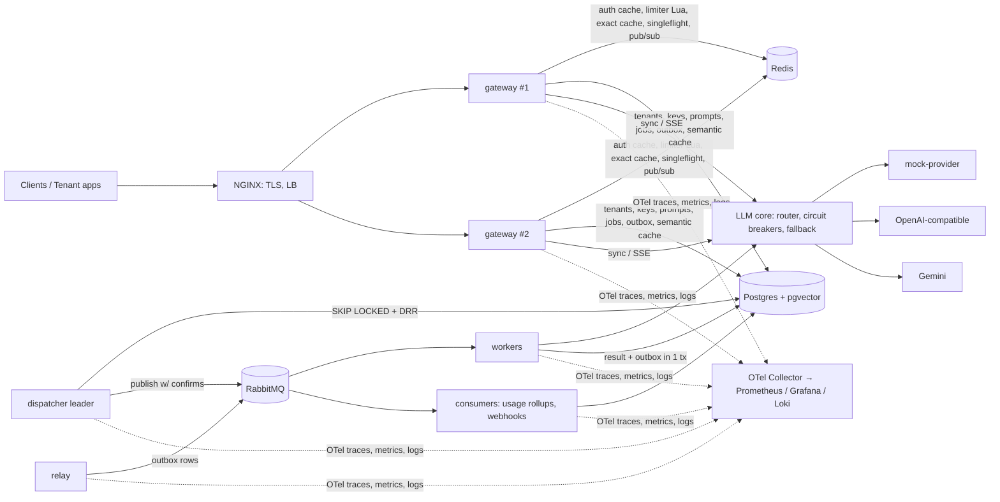

# CONDUIT — Master Build Prompt for Claude Code

> Paste this whole file into Claude Code as the first message in an empty folder (or save it as `docs/MASTER_PROMPT.md` in the repo and tell Claude Code: "Read docs/MASTER_PROMPT.md and start Phase 0").

---

## 0. How you (Claude Code) must work

You are acting as a **Principal Backend Engineer + Distributed Systems Architect + SRE** building **Conduit**, a production-grade project for a backend / AI-infrastructure engineering portfolio. The bar is "what an engineer with ~1 year at a big tech company would own end-to-end": a service with SLOs, capacity numbers, documented failure modes, measured performance, safe rollouts, and design docs a reviewer could interrogate.

Operating rules (these override any convenience shortcut):

1. **Read this entire document before writing code.** Then create `CLAUDE.md` at the repo root containing: the North Star (§1), the six Proof Claims (§1.2), the Approved Stack (§4), the Non-Goals (§3), the Engineering Rules (§13) and the Direction Check (§12). Re-read `CLAUDE.md` at the start of every phase and every new session.
2. **Work phase by phase (§11).** One branch + one PR per phase. A phase is done only when its **Gate** passes and the **Direction Check** (§12) is answered in the PR description.
3. **Maintain `PROGRESS.md`** at the repo root: current phase, done/remaining checklist, open issues, decisions taken, next step. Update it before every commit that ends a work session, so a fresh session can resume from it alone.
4. **Never fabricate results.** Every number in docs or README must come from a committed artifact (k6 JSON, test log, EXPLAIN ANALYZE output) or be explicitly labelled `TARGET` or `ESTIMATE`.
5. **STOP and ask the human** before: changing the Approved Stack; adding any component not listed in §4; anything that costs money (`terraform apply`, launching cloud instances, paid API keys); destructive actions (`terraform destroy`, dropping data, force-push, rewriting history on `main`); and at the end of Phase 1 (HLD review).
6. Prefer boring, correct code over clever code. Every infrastructure component must solve a problem you can name and demonstrate.

---

## 1. What Conduit is

**Conduit is a multi-tenant LLM traffic control plane**: one service that sits between many internal apps/teams ("tenants") and many LLM providers. Every LLM call goes through Conduit, which decides **who may call, how much, at what priority, from cache or not, through which provider, with which prompt version**, and records what it cost.

The AI is the *workload*. The *product* is the backend: rate limiting, queues, caching, scheduling, failover, measurement.

### 1.1 North Star

> A deployed, measured, failure-tested system on AWS that proves the author can design, build, operate and benchmark a distributed backend under load, with Redis, a message broker, distributed rate limiting and an automated prompt-optimization pipeline as first-class components.

### 1.2 The six Proof Claims (everything built must serve at least one)

| # | Claim | Evidence artifact |
|---|---|---|
| P1 | The token-based rate limiter stays accurate across N gateway replicas under concurrent load | Over-admission % from a k6 + multi-replica test |
| P2 | One noisy tenant cannot degrade others | Victim tenant p99 with vs without fair scheduling, under a 10× flood |
| P3 | Async jobs are never lost or double-executed under worker kills, redeliveries and broker restarts | Chaos test log: N faults, 0 lost, 0 duplicate side effects |
| P4 | Caching is fast and correct | Hit ratio, latency before/after, semantic-cache precision on a labelled set |
| P5 | Prompt optimization reduces cost without reducing quality | Token cost delta at equal-or-better eval score, with canary rollout + auto-rollback |
| P6 | The system scales and degrades gracefully | Concurrency ladder (100 / 1k / 5k / 10k) with p50/p95/p99, RPS, errors, bottleneck analysis, plus a failure-matrix report |

---

## 2. User stories (product side)

Personas: **Platform Admin** (runs Conduit), **Tenant Developer** (builds an app that calls LLMs), **Batch User** (submits bulk work), **Prompt Owner** (owns a prompt used in production), **On-call SRE**.

Each story has acceptance criteria (AC). These ACs become integration tests.

**US-1 Onboard a tenant** — As a Platform Admin, I create a tenant, set its quotas (RPM, TPM, max concurrency, monthly token budget, fair-share weight) and issue API keys.
- AC: API keys are shown once, stored only as a hash, display a prefix (`cdt_live_ab12…`), can be scoped and revoked; revocation takes effect across all gateway replicas within 5 s.
- AC: every admin action writes an audit log entry.

**US-2 Make an interactive LLM call** — As a Tenant Developer, I call an OpenAI-compatible `POST /v1/chat/completions` (sync or `stream: true`) with my API key and get a response without caring which provider served it.
- AC: streaming works over SSE; if the client disconnects mid-stream, the upstream call is cancelled and only consumed tokens are billed.
- AC: the response includes `X-Request-ID`, `X-Conduit-Cache: hit|miss|semantic-hit`, `X-Conduit-Provider`, and rate-limit headers (`X-RateLimit-Remaining-Tokens`, `Retry-After` on 429).

**US-3 Be protected from other tenants** — As a Tenant Developer, my latency should not spike because another tenant floods the system.
- AC: under a 10× flood from tenant B, tenant A's p99 stays within a documented bound of its baseline (measured, P2).

**US-4 Submit bulk work** — As a Batch User, I submit a batch of up to 10,000 prompts via `POST /v1/batches` with an `Idempotency-Key`, then poll or receive a webhook when it's done.
- AC: re-submitting with the same key returns the same batch, never a duplicate.
- AC: each item is executed effectively once; failures retry with backoff; permanently failing items land in a DLQ visible to the tenant; partial results are retrievable.
- AC: interactive traffic always beats batch traffic for capacity.

**US-5 Version and optimize a prompt** — As a Prompt Owner, I register a prompt template, attach a golden eval dataset, run evaluations, launch an optimization run, and promote the winner through a canary.
- AC: prompt versions are immutable; apps reference prompts by name and get the active version.
- AC: the optimizer produces a report: baseline vs candidate score, avg input/output tokens, cost per 1k calls.
- AC: a canary at X% traffic auto-rolls back if its online error or schema-violation rate exceeds the baseline by a threshold.

**US-6 See usage and cost** — As a tenant admin, I see requests, tokens, cache hits, cost and errors per hour/day per model.

**US-7 Survive provider outages** — As a Tenant Developer, when the primary provider fails or slows, my calls fall back to the next provider in my route.
- AC: a circuit breaker opens after a configurable failure threshold; half-open probes restore it.
- AC: if every provider is down, I get a fast 503 with `Retry-After`, not a hang; batch dispatch pauses for that route and resumes automatically.

**US-8 Operate it** — As the On-call SRE, I have dashboards for golden signals, rate limiter, cache, queues, workers, providers and cost, plus alerts and a runbook for each failure mode.

---

## 3. Scope and Non-Goals

**In scope:** everything in §2, deployed on AWS (free-plan-eligible resources), with load tests, failure tests and docs.

**Non-goals (do NOT build these):**
- No agent frameworks, multi-agent orchestration, or LangChain/LangGraph inside Conduit. Conduit is infrastructure.
- No microservices split at the start. Build a **modular monolith** with clean module boundaries and separate *processes* (gateway, worker, dispatcher, relay, mock-provider). Document in an ADR how a module would be extracted later.
- No Kafka, no Kubernetes in the main path (k3s is an optional final stage only if the human approves).
- No GPU, no self-hosted large models.
- No polished UI. The dashboard is a minimal Next.js static export (Phase 11).
- No real-provider spend in tests or load tests. The **Mock LLM Provider** carries all load.

---

## 4. Approved stack (fixed unless the human approves a change)

| Concern | Choice | Notes |
|---|---|---|
| Language | Python 3.12 | `uv` for packaging; `ruff` + `mypy --strict` on `src/` |
| API | FastAPI + Uvicorn (uvloop) | Pydantic v2 everywhere |
| DB | PostgreSQL 16 (local: Docker; prod: Neon free tier or RDS, decided by ADR) | SQLAlchemy 2.0 async + asyncpg, Alembic migrations, `pgvector` extension |
| Cache / limiter / locks / pub-sub | Redis 7 (plain OSS; no modules required) | redis-py asyncio; Lua scripts for atomic operations |
| Broker | RabbitMQ 3.13+ (management plugin on) | aio-pika; publisher confirms; manual acks |
| HTTP client | httpx (async) | explicit connect/read/total timeouts |
| Embeddings | Provider abstraction: `fastembed` (ONNX, small model, CPU) default; deterministic mock embeddings for tests | keep RAM in mind |
| Mock LLM Provider | Own FastAPI service in this repo | see §6.9 |
| Real providers | OpenAI-compatible adapter + Gemini adapter | only for demos/eval runs, behind a hard daily budget |
| Observability | OpenTelemetry SDK → OTel Collector; Prometheus; Grafana; Loki | in prod, ship to Grafana Cloud free tier to save RAM (ADR) |
| Reverse proxy / LB / TLS | NGINX + certbot (Let's Encrypt) | load balances across gateway replicas |
| Frontend | Next.js (App Router), static export, served by NGINX | Phase 11 only |
| Load testing | k6 | scripts + raw JSON results committed |
| Fault injection | Toxiproxy + `docker kill`/`pause` scripts | |
| Testing | pytest, pytest-asyncio, testcontainers (real Postgres/Redis/RabbitMQ), hypothesis for limiter properties | no mocking of Redis/Postgres/RabbitMQ in integration tests |
| CI/CD | GitHub Actions | lint, type-check, tests, build multi-arch images, push to GHCR, deploy |
| IaC | Terraform | AWS provider |
| Cloud | AWS free plan | EC2 `t4g.small` (ARM64, always-on), burst `m7i-flex.large` for load tests, SSM Parameter Store for secrets, AWS Budgets alarm, GitHub OIDC role (no long-lived keys) |

---

## 5. High-Level Design (HLD)

### 5.1 Processes

| Process | Replicas (prod) | Responsibility |
|---|---|---|
| `gateway` | 2 behind NGINX | Auth, rate limiting, caching, routing, sync + SSE calls, job/batch admission, admin + prompt APIs |
| `dispatcher` | 2 (1 active via leader election) | Fair-schedules QUEUED jobs from Postgres into RabbitMQ, enforces backpressure, reclaims expired leases, reconciles DB↔broker drift |
| `worker` | 2+ | Consumes jobs, calls LLM core, writes results + outbox events, handles retries/DLQ |
| `relay` | 1 (leader-elected) | Publishes outbox rows to the `conduit.events` exchange |
| `consumers` | 1 | Usage aggregator (rollups), webhook notifier, eval-result collector |
| `mock-provider` | 1 | Simulated LLM with configurable latency/errors/streaming |
| Infra | 1 each | Postgres (or managed), Redis, RabbitMQ, NGINX, observability stack |

All Python processes share one codebase (`src/conduit/`); each is a different entrypoint.

### 5.2 Architecture diagram (put a polished version in `docs/HLD.md`)



### 5.3 Request lifecycle: sync / stream (`POST /v1/chat/completions`)

1. NGINX terminates TLS, adds/forwards `X-Request-ID`, load-balances.
2. **Admission guard**: if gateway in-flight > shed threshold or event-loop lag > threshold → 503 + `Retry-After` (load shedding).
3. **Auth**: hash the API key → L1 (in-process LRU, 30 s TTL) → L2 (Redis) → Postgres. Invalidation of revoked keys and changed quotas via Redis pub/sub channel `conduit:cfg-invalidate`, so all replicas drop L1 entries.
4. **Request validation**: Pydantic schema, max body size, max messages, max `max_tokens`, model allowed for tenant.
5. **Prompt resolution** (if `prompt` ref used): pick the active vs canary version by deterministic hash of `(request_id or user field)`; render template.
6. **Rate limiting** (§6.4): RPM sliding window → per-tenant concurrency semaphore → TPM token-bucket *reservation* (input tokens + estimated output) → per-provider global budget. Any reject → 429 with `Retry-After`.
7. **Exact cache** (only if cacheable: `temperature == 0` or explicit `cache: true`): Redis GET. Hit → refund reservation, return.
8. **Semantic cache** (opt-in per tenant/route): embed the normalized request, pgvector ANN search scoped by `(tenant, prompt_version, model)`; similarity ≥ threshold → return.
9. **Singleflight**: identical in-flight cacheable requests coalesce; only one goes upstream (in-process future map + Redis `SET NX PX` lock across replicas).
10. **Route + call**: router picks a provider from the route's chain, skipping open circuits; per-attempt timeouts (connect, TTFT, total); retry only before the first token is streamed; fallback to next provider.
11. **Stream** tokens to the client over SSE; on client disconnect, cancel the upstream request.
12. **Reconcile** the token reservation with actual usage (refund or charge the difference), release the concurrency slot, write the cache, and emit a usage event (an in-memory bounded buffer flushed in batches into Postgres `usage_events` + outbox; ADR covers loss trade-off if Postgres is down).
13. Emit metrics + trace span; return.

### 5.4 Request lifecycle: async (`POST /v1/batches`, `POST /v1/jobs`)

1. Auth + validation + per-tenant `max_queued_jobs` admission (429 if exceeded) + global queue-depth shedding for low priority (503).
2. In **one Postgres transaction**: insert the batch + jobs with status `QUEUED` and unique `(tenant_id, idempotency_key)`; insert outbox event `batch.created`. Duplicate key → return the existing batch (200, same body).
3. Return 202 with batch ID.
4. **Dispatcher (leader)** loop: compute available capacity = `max_inflight − inflight`; run **Deficit Round Robin** over tenants with QUEUED jobs, weighted by `quotas.weight`; claim jobs with `SELECT … FOR UPDATE SKIP LOCKED`, set `DISPATCHED`, publish to RabbitMQ with publisher confirms (priority from job class). Publish failure → revert to `QUEUED`.
5. **Worker** receives a message → conditional `UPDATE jobs SET status='RUNNING', lease_owner, lease_expires_at, attempts=attempts+1 WHERE id=$1 AND status='DISPATCHED' AND attempts=$msg_attempt RETURNING *`. Zero rows → duplicate/stale message → ack and drop (idempotent consumer).
6. Heartbeat extends the lease during the call. LLM call goes through the same LLM core (rate limiter included: batch traffic uses the provider budget at lower priority).
7. Success → one transaction: write result, `SUCCEEDED`, usage row, outbox `job.succeeded` → then ack.
8. Retryable failure → `RETRY_WAIT` + publish to delay queue (5 s / 30 s / 120 s + jitter) → ack. Max attempts reached → `DEAD`, publish to `jobs.dlq`, outbox `job.dead` → ack.
9. **Reconciler** (in dispatcher): expired leases → back to `QUEUED`; `DISPATCHED`/`RETRY_WAIT` older than its deadline with no broker message → re-dispatch. **Postgres is the source of truth; the broker is transport.**
10. **Relay** publishes outbox rows to `conduit.events`; consumers update `usage_hourly`, fire webhooks, aggregate eval results. Consumers are idempotent via `processed_messages(consumer, message_id)`.

### 5.5 Failure-isolation principles

- Redis outage must not stop serving: limiter falls back to a **conservative in-process limiter** (per-replica share of the tenant limit), caches are bypassed, singleflight is in-process only. `/readyz` reports degraded. Alert fires.
- RabbitMQ outage must not lose jobs: they stay `QUEUED` in Postgres; dispatcher retries publishing with backoff.
- Postgres outage: sync calls continue for keys already in L1/L2 for a bounded window; usage writes buffer in a bounded queue (counter for dropped events); job/batch creation and admin APIs return 503.
- Provider outage: circuit breaker + fallback chain; all-down → fast 503.
- **Bulkheads**: separate connection pools / semaphores for interactive vs batch vs admin paths so one cannot starve the others.

---

## 6. Low-Level Design (LLD)

### 6.1 Repository layout

```
Conduit/
├── CLAUDE.md  PROGRESS.md  README.md  CHANGELOG.md  Makefile  pyproject.toml
├── src/conduit/
│   ├── api/            # FastAPI routers: chat, jobs, batches, prompts, evals, usage, admin, health
│   ├── auth/           # api keys, JWT, refresh rotation, RBAC, audit
│   ├── ratelimit/      # lua/*.lua, limiter layers, AIMD, local fallback
│   ├── cache/          # L1/L2, exact, semantic, singleflight, invalidation
│   ├── llm/            # provider adapters, router, circuit breaker, retries, token counting, streaming
│   ├── prompts/        # registry, rendering, canary selection
│   ├── evals/          # datasets, scorers, runner, optimizer strategies
│   ├── jobs/           # models, admission, dispatcher (DRR, leader election), worker, reconciler
│   ├── messaging/      # rabbitmq topology, publisher w/ confirms, consumer base, outbox relay
│   ├── usage/          # metering buffer, rollups, cost calc
│   ├── db/             # session, models, repositories
│   ├── observability/  # otel setup, metrics registry, logging, correlation ids
│   ├── security/       # input guards, PII redaction, validation limits
│   ├── config.py
│   └── entrypoints/    # gateway.py, dispatcher.py, worker.py, relay.py, consumers.py
├── mock_provider/
├── migrations/         # alembic
├── tests/{unit,integration,chaos,security}/
├── bench/{k6/,results/,reports/}
├── chaos/              # toxiproxy configs + scripts
├── deploy/{compose/,nginx/,grafana/,prometheus/,otel/,loki/}
├── infra/terraform/
├── web/                # Next.js dashboard (Phase 11)
├── docs/{HLD.md,LLD.md,ARCHITECTURE.md,API_DOCUMENTATION.md,DATABASE_DESIGN.md,DEPLOYMENT.md,SECURITY.md,SCALABILITY.md,FAILURE_TESTING.md,BENCHMARKS.md,TROUBLESHOOTING.md,CONTRIBUTING.md,RUNBOOK.md,adr/}
└── .github/workflows/
```

### 6.2 Database schema (Postgres)

Write these as Alembic migrations. Use UUIDv7 (time-ordered) or bigserial where noted; `timestamptz` everywhere.

- `tenants(id, slug UNIQUE, name, tier, status, created_at)`
- `users(id, tenant_id NULL, email UNIQUE, password_hash, role, created_at)` (role ∈ platform_admin, tenant_admin, developer, viewer)
- `refresh_tokens(id, user_id, token_hash UNIQUE, family_id, expires_at, revoked_at, replaced_by)`: rotation with reuse detection (reuse of a rotated token revokes the whole family)
- `api_keys(id, tenant_id, name, prefix, key_hash UNIQUE, scopes text[], status, last_used_at, created_at, revoked_at)`
- `quotas(tenant_id PK, rpm, tpm, max_concurrency, max_queued_jobs, monthly_token_budget, weight, updated_at)`
- `providers(id, name UNIQUE, kind, base_url, enabled, config jsonb)`
- `models(id, provider_id, name, input_cost_per_1k_micros, output_cost_per_1k_micros, context_window, enabled)`
- `routes(id, tenant_id NULL, name, model_chain jsonb, strategy, semantic_cache_enabled, semantic_threshold)`
- `prompts(id, tenant_id, name, active_version_id, canary_version_id NULL, canary_percent, UNIQUE(tenant_id,name))`
- `prompt_versions(id, prompt_id, version int, template text, variables_schema jsonb, few_shot jsonb, model_params jsonb, output_schema jsonb NULL, token_estimate int, source, parent_version_id NULL, created_by, created_at, UNIQUE(prompt_id,version))`: rows never updated
- `eval_datasets(id, tenant_id, name)`, `eval_examples(id, dataset_id, input jsonb, expected jsonb, tags text[])`
- `eval_runs(id, prompt_version_id, dataset_id, status, score, avg_input_tokens, avg_output_tokens, cost_micros, started_at, finished_at)`
- `eval_results(id, run_id, example_id, output jsonb, score, input_tokens, output_tokens)`
- `optimization_runs(id, prompt_id, base_version_id, strategy, epsilon, status, best_version_id NULL, report jsonb)`
- `batches(id, tenant_id, idempotency_key, status, total, succeeded, failed, dead, webhook_url NULL, created_at, UNIQUE(tenant_id,idempotency_key))`
- `jobs(id, tenant_id, batch_id NULL, kind, priority smallint, status, payload jsonb, result jsonb NULL, error jsonb NULL, attempts, max_attempts, lease_owner, lease_expires_at, next_attempt_at, created_at, updated_at)`
  - partial index `(tenant_id, priority DESC, created_at) WHERE status='QUEUED'`
  - index `(lease_expires_at) WHERE status='RUNNING'`
- `outbox(id bigserial, aggregate_type, aggregate_id, event_type, payload jsonb, created_at, published_at NULL)`, partial index `WHERE published_at IS NULL`
- `processed_messages(consumer, message_id, processed_at, PRIMARY KEY(consumer,message_id))`
- `usage_events(id, tenant_id, api_key_id, request_id, provider, model, prompt_version_id NULL, input_tokens, output_tokens, cache_status, cost_micros, latency_ms, status, created_at)` **PARTITION BY RANGE (created_at)**, monthly partitions, with a job that creates future partitions and detaches/archives old ones
- `usage_hourly(tenant_id, hour, model, requests, input_tokens, output_tokens, cost_micros, cache_hits, errors, PRIMARY KEY(tenant_id,hour,model))`
- `semantic_cache(id, tenant_id, scope_key, embedding vector(dims), request_hash, response jsonb, created_at, expires_at, hits)` with HNSW index; always filter by `tenant_id` + `scope_key`
- `audit_log(id bigserial, actor_type, actor_id, tenant_id, action, target, metadata jsonb, ip, created_at)`

Money is stored as integer **micros**, never floats. Document every index with the query it serves in `DATABASE_DESIGN.md`, plus `EXPLAIN ANALYZE` before/after for the hot queries (dispatcher claim, usage rollup, auth lookup).

Connection pooling: size pools per process from a documented formula; if using Neon's pooled (PgBouncer, transaction mode) endpoint, disable asyncpg prepared-statement caching and document why.

### 6.3 Redis key design

| Key | Type | Purpose | TTL |
|---|---|---|---|
| `rl:rpm:{key_id}:{window}` | string counters | sliding-window-counter RPM | 2× window |
| `rl:tpm:{tenant}` | hash `{tokens, ts}` | token bucket (TPM) | idle expiry |
| `rl:res:{request_id}` | hash | outstanding reservation for reconcile | max request time + grace |
| `rl:conc:{tenant}` | zset `request_id → expiry` | concurrency semaphore with lease (stale entries pruned in Lua) | — |
| `rl:prov:{provider}` | hash `{limit, tokens, ts}` | global provider budget, AIMD-adjusted | — |
| `cache:x:{tenant}:{sha256}` | string (compressed JSON) | exact response cache | per-route TTL + jitter |
| `sf:{sha256}` | string | singleflight lock (`SET NX PX`) | short |
| `cfg:tenant:{id}`, `cfg:key:{hash}` | string | L2 config/auth cache | 60 s + jitter |
| channel `conduit:cfg-invalidate` | pub/sub | L1 invalidation across replicas | — |
| `cb:{provider}` | hash | shared circuit state (ADR: shared vs per-process) | — |

Rules: **all time comes from Redis `TIME` inside Lua** (no cross-replica clock skew); keys are namespaced, have TTLs, and all TTLs get jitter (cache-avalanche protection). Set `maxmemory` + `allkeys-lru` (ADR: why LRU vs LFU for this workload). AOF `everysec` on.

### 6.4 Rate limiting (four layers + traffic management)

1. **RPM per API key**: sliding window counter (Lua).
2. **Concurrency per tenant**: semaphore with leased slots (zset + expiry), so crashed requests don't leak slots.
3. **TPM per tenant**: token bucket with **reserve → reconcile**:
   - `reserve(tenant, est_tokens)`, where `est = input_tokens + min(max_tokens, p95_output_tokens_for_model)` → atomically checks and deducts; returns `allowed, remaining, retry_after_ms`.
   - `reconcile(request_id, actual_tokens)` → refunds or charges the difference (bucket may go negative = debt, which delays the next admission).
   - Orphaned reservations (gateway crashed) simply expire: conservative and safe. Document this.
4. **Global provider budget** shared by all tenants, with **AIMD**: on provider 429/overload → `limit *= 0.5`; on each healthy interval → `limit += step`, up to configured max.

Plus:
- **Priority**: interactive > batch at every shared limiter (batch gets only the residual provider budget).
- **Load shedding**: early 503 on gateway overload (in-flight / event-loop lag thresholds).
- **Quotas**: monthly token budget enforced from `usage_hourly` + Redis counter.
- **Degraded mode** when Redis is unreachable: an in-process limiter with `limit / replica_count`; emits `conduit_ratelimit_degraded=1`.
- **Property tests** (hypothesis): never admit more than capacity + one max-request burst in any window.
- **Accuracy test (P1)**: N gateway replicas × M concurrent clients against one tenant with a known TPM; measure admitted tokens vs the theoretical maximum and report **over-admission %**.

### 6.5 RabbitMQ topology

- Exchange `conduit.jobs` (direct) → queue `jobs.work` (durable, classic, `x-max-priority=3`).
- Exchange `conduit.retry` → queues `jobs.retry.5s`, `jobs.retry.30s`, `jobs.retry.120s`, each with `x-message-ttl` and `x-dead-letter-exchange=conduit.jobs` (delayed retry without plugins).
- Exchange `conduit.dlx` → queue `jobs.dlq`, plus an admin API to inspect and replay.
- Exchange `conduit.events` (topic) → queues `events.usage`, `events.webhooks`, `events.evals`.
- Publishing uses **publisher confirms**, `delivery_mode=persistent`, `message_id = {job_id}:{attempt}`, and a W3C `traceparent` header.
- Consumers use manual ack, tuned `prefetch_count` (benchmark it), and graceful shutdown (stop consuming, finish in-flight within a deadline, nack-requeue the rest).
- Topology is declared idempotently at startup and exported to `deploy/rabbitmq/definitions.json`.
- Write `docs/adr/ADR-00X-broker.md` comparing RabbitMQ vs Kafka vs Redis Streams for *this* workload (per-message ack, priorities, delayed retry, DLQ vs replayable log), and record why Redis is **not** the broker (failure isolation).

### 6.6 Fair scheduler (dispatcher)

- **Leader election** via Postgres advisory lock (`pg_try_advisory_lock`); the standby takes over within N seconds of leader death (measure it).
- **Deficit Round Robin** across tenants with QUEUED jobs, quantum ∝ `quotas.weight`; within a tenant, order by priority then age.
- **Backpressure**: never publish more than `max_inflight` (configured from worker count × concurrency). When workers fall behind, jobs wait in Postgres, not in RabbitMQ. Queue depth stays bounded by design.
- Expose metrics: per-tenant queued, dispatched rate, deficit counters, inflight.
- **P2 experiment**: tenant B floods 10× its share; compare tenant A's p99 time-to-start with FIFO dispatch vs DRR (feature flag).

### 6.7 Caching details

- **L1**: in-process TTL-LRU for config/auth (bounded size); **L2**: Redis. Invalidation via pub/sub; correctness test: revoke a key, then assert rejection on every replica within 5 s.
- **Exact cache**: key = sha256 of canonical JSON `{tenant, model, prompt_version, messages, params}`; only cacheable requests; compressed values; TTL + jitter.
- **Stampede protection**: singleflight (in-process futures + Redis lock + bounded wait, then fall through).
- **Penetration**: cache negative results for invalid API keys briefly (tiny TTL) to stop DB hammering.
- **Semantic cache**: pgvector HNSW; threshold tuned on a labelled set of ~200 query pairs (same-answer vs different-answer). Report precision/recall per threshold; ship the threshold with ≥ 0.98 precision. Never cross tenant or prompt-version scope.
- **Benchmark**: cache off vs exact vs exact + semantic, reporting latency and token savings.

### 6.8 LLM core

- `Provider` interface: `complete()`, `stream()`, `count_tokens()`, `embed()` (optional), `health()`.
- Adapters: `mock`, `openai_compatible`, `gemini`.
- **Router**: route = ordered model chain; skip providers whose circuit is open; optional cost-aware routing (cheapest model whose eval score for this prompt meets the threshold).
- **Circuit breaker**: rolling-window failure rate + slow-call rate → OPEN → HALF_OPEN probes.
- **Retries**: exponential backoff with full jitter, only for retryable errors and only before the first streamed token; overall deadline propagated.
- **Timeouts**: connect, TTFT, inter-token idle, total.
- **Structured output**: if `output_schema` is set, validate the JSON; one repair attempt; count schema violations (feeds canary rollback).
- **Token counting**: tokenizer per provider where available, otherwise a documented approximation.

### 6.9 Mock LLM Provider (critical for testing)

OpenAI-compatible endpoints. Configurable per request (headers) or globally (admin endpoint):
- TTFT distribution (fixed / normal / lognormal), tokens per second, output length distribution;
- error injection: rate of 429 / 500 / timeouts / connection resets / mid-stream drops;
- deterministic output from a seed (so cache and eval tests are reproducible);
- an "eval mode" that scores prompt quality deterministically from prompt features (so the optimizer pipeline is testable in CI without real models).

It must sustain more load than the gateway (it must never be the bottleneck in benchmarks; verify and document this).

### 6.10 Prompt registry, evals, optimizer, canary

- Registry CRUD; versions immutable; render with strict variable validation.
- **Scorers**: exact match, JSON-schema validity, field-level F1, regex, and LLM-as-judge (real model, budget-capped; calibrate against ~50 human labels and report agreement).
- **Eval runs execute as batch jobs through the same queue** (dogfooding the async system).
- **Optimizer strategies** (pluggable):
  1. few-shot pruning: greedy removal of examples while `score ≥ baseline − ε`;
  2. instruction compression: generate candidate shorter instructions, evaluate, keep the Pareto-best (score vs tokens);
  3. optional DSPy-based strategy, behind a flag.
- Objective: **minimize avg tokens subject to score ≥ baseline − ε**. Output a report (table + JSON).
- **Canary**: promote the candidate at X% via deterministic hashing; online monitor compares error rate, schema-violation rate and latency vs baseline; auto-rollback on threshold breach; every transition is audit-logged.

### 6.11 Security

- Passwords with Argon2id; API keys of 32+ random bytes stored as SHA-256; constant-time compare.
- JWT access token (short TTL) + rotating refresh tokens with reuse detection; RBAC enforced by a dependency on every route; tenant isolation enforced in the repository layer (every query takes `tenant_id`) and tested with cross-tenant attack tests.
- Request limits (body size, message count, `max_tokens`); strict CORS; security headers at NGINX; HTTPS only.
- Secrets only from environment variables loaded from SSM Parameter Store in prod; `.env.example` in the repo; `gitleaks` in CI.
- Prompt-injection guard (heuristic classifier + system-prompt isolation + output validation) as a module with its own test set and false-positive rate.
- PII redaction in logs and traces (emails, phone numbers, API keys).
- `SECURITY.md` with a STRIDE threat model, plus `tests/security/` (SQLi attempts, auth bypass, IDOR across tenants, JWT tampering, refresh reuse, oversized payloads).

### 6.12 Observability

- OTel traces: HTTP → limiter → cache → provider call; trace context propagated through RabbitMQ headers into workers and consumers; DB/Redis/httpx auto-instrumentation.
- Structured JSON logs (structlog) with `request_id`, `trace_id`, `tenant_id`, PII-redacted → Loki.
- Prometheus metrics (keep label cardinality bounded: tenant **tier**, never tenant id, on high-volume series):
  `conduit_http_request_duration_seconds`, `conduit_http_requests_total`, `conduit_ratelimit_decisions_total{layer,result}`, `conduit_ratelimit_degraded`, `conduit_cache_requests_total{layer,result}`, `conduit_llm_ttft_seconds`, `conduit_llm_request_duration_seconds`, `conduit_llm_tokens_total{direction,provider}`, `conduit_llm_cost_micros_total{provider}`, `conduit_circuit_state{provider}`, `conduit_jobs_total{status}`, `conduit_job_queue_wait_seconds`, `conduit_dispatcher_inflight`, `conduit_outbox_lag_seconds`, `conduit_db_pool_in_use`, `conduit_event_loop_lag_seconds`, plus RabbitMQ / Redis / Postgres / node exporters.
- Grafana dashboards provisioned as JSON in `deploy/grafana/`: Golden Signals, Rate Limiter, Cache, Queues & Workers, Providers, Cost & Usage, Prompt Canary.
- Alerts: error rate, p99 latency SLO burn, queue wait, DLQ growth, outbox lag, circuit open, Redis degraded mode, budget.
- `RUNBOOK.md`: one section per alert.

### 6.13 API surface (document in OpenAPI + `API_DOCUMENTATION.md`)

- `POST /v1/chat/completions` (sync + SSE)
- `POST /v1/jobs`, `GET /v1/jobs/{id}`, `POST /v1/jobs/{id}/cancel`
- `POST /v1/batches`, `GET /v1/batches/{id}`, `GET /v1/batches/{id}/results` (cursor pagination)
- `GET /v1/usage?from&to&granularity`
- `/v1/prompts`, `/v1/prompts/{name}/versions`, `/v1/prompts/{name}/canary`
- `/v1/evals/datasets`, `/v1/evals/runs`, `/v1/optimizations`
- `/admin/tenants`, `/admin/tenants/{id}/quotas`, `/admin/api-keys`, `/admin/providers`, `/admin/routes`, `/admin/dlq` (list/replay)
- `/auth/login`, `/auth/refresh`, `/auth/logout`
- `/healthz` (liveness), `/readyz` (dependency checks with degraded states), `/metrics`

All APIs are versioned under `/v1`; error format is `{error: {type, code, message, request_id}}`; `Idempotency-Key` is supported on all POSTs that create resources.

---

## 7. Scalability plan

Run the concurrency ladder **100 → 1,000 → 5,000 → 10,000** virtual users (streaming and non-streaming mixes) against mock-provider profiles:
- **S1 overhead**: mock with zero latency, to isolate gateway cost;
- **S2 realistic**: TTFT around 300 ms, around 40 tokens/s, 200-token outputs;
- **S3 flaky**: 5% 429s, 2% 500s, 1% timeouts.

For each level record: RPS, p50/p95/p99, error rate, DB pool usage, Redis ops/s, queue depth, consumer lag, CPU, memory, network, plus an estimated cost.

For each level write: where the bottleneck appeared, how you found it (which metric or trace), the fix, what was scaled, and the before/after. Document when vertical scaling stopped helping (e.g. single-process CPU ceiling) and how horizontal scaling plus NGINX upstreams fixed it. Check OS limits (file descriptors, somaxconn) for 10k concurrent SSE connections.

Run heavy tests on the burst instance and the k6 load generator on a **separate** instance. Record exact hardware in every report. If a target is not reached, the documented ceiling and the reason **is** the result; never massage numbers.

Additional experiments:
- **S4** limiter accuracy (P1);
- **S5** noisy neighbour (P2);
- **S6** cache on/off (P4);
- **S7** producers faster than consumers (queue growth, backpressure, shedding);
- **S8** recovery time after killing the dispatcher leader, a worker, or Redis.

---

## 8. Failure-testing matrix (→ `FAILURE_TESTING.md`)

For each scenario: steps (scripted in `chaos/`), expected behaviour, observed behaviour, metrics/screenshots, pass/fail.

| Scenario | Expected |
|---|---|
| Redis down | Degraded local limiter, cache bypass, sync traffic served, alert fires, automatic recovery |
| Postgres down | Sync calls continue for cached keys within window; creates → 503; no data corruption on recovery |
| RabbitMQ down | Job creation still 202; jobs stay QUEUED; dispatch resumes; 0 lost |
| Worker `kill -9` mid-job | Lease expires → re-dispatched; 0 lost; 0 duplicate results |
| Duplicate message delivery (injected) | Idempotent no-op |
| Dispatcher leader killed | Standby acquires lock within N s |
| Slow provider (Toxiproxy latency) | TTFT timeout → fallback; circuit opens on slow-call rate |
| Provider outage (100% 500s) | Circuit open, fallback chain, fast 503 when exhausted, batch pause/resume |
| Traffic spike 10× | Shedding + 429s; admitted p99 stays bounded; no crash |
| DB connection exhaustion | Pool timeout → fast 503, no hang; bulkhead keeps interactive path alive |
| Network partition / timeouts | Bounded latency, retries with jitter, no retry storm |
| Malicious requests | Rejected with correct codes; no cross-tenant access |
| Mid-stream client disconnect | Upstream cancelled; partial tokens billed correctly |

Also produce **one aggregate chaos run** (randomized faults over ~30 minutes with continuous load) reporting totals: jobs submitted, succeeded, dead, lost (must be 0), duplicated (must be 0).

---

## 9. Deployment (AWS free plan)

- **Environments**:
  - **local**: full Docker Compose including the observability stack.
  - **staging**: ephemeral compose stack on the burst instance, used for load/chaos tests, then stopped.
  - **production**: always-on `t4g.small`.
- **Prod host (t4g.small, ARM64)**: NGINX, gateway ×2, worker ×2, dispatcher ×2, relay, consumers, mock-provider, Redis, RabbitMQ; Postgres on Neon free tier or RDS (ADR); observability shipped to Grafana Cloud free tier (verify current limits); dashboard as static files on NGINX. Keep a **memory budget table** in `DEPLOYMENT.md` and set container memory limits; add swap.
- **Images**: multi-stage Dockerfiles, non-root user, slim base, **multi-arch (amd64 + arm64)** via buildx, pushed to GHCR, tagged by git SHA.
- **Terraform** (`infra/terraform/`): security groups (only 80/443 public; SSH via SSM Session Manager instead of open port 22), EC2 + Elastic IP, IAM instance role, SSM parameters, AWS Budgets alarm, GitHub OIDC deploy role. **Ask the human before every `apply`.**
- **CI/CD (GitHub Actions)**:
  - on PR: ruff, mypy, unit + integration tests (testcontainers), gitleaks, image build.
  - on merge to `main`: build + push images, deploy to prod over SSM (pull images, run `alembic upgrade`, rolling restart one gateway replica at a time behind NGINX, health-gate, auto-rollback to the previous SHA on failed health checks).
- **TLS**: Let's Encrypt via certbot with auto-renewal; domain via the human's DNS (ask the human for the domain; a free dynamic-DNS subdomain is acceptable).
- **Backups**: Postgres via provider PITR + nightly `pg_dump` to S3 with lifecycle expiry; Redis AOF; RabbitMQ definitions export. **Test a restore** and document it.
- **Docs**: `DEPLOYMENT.md` with rollback, backup/restore, secret rotation, and the "credits/free-plan end" migration plan (everything is Compose, so it can move to any VM).

---

## 10. Git and GitHub workflow

- Repo: **`Conduit`** on the human's GitHub account. Verify with `gh auth status` and `gh api user` before anything else; if the repo doesn't exist, ask before creating it (`gh repo create Conduit --public`).
- Commit identity (set locally in the repo):
  ```
  git config user.email "prajinrajranawat@gmail.com"
  git config user.name  "Prajinraj Ranawat"
  ```
  Then verify the email is attached and verified on the GitHub account: `gh api user/emails`. If it isn't, STOP and tell the human (otherwise commits won't count on their profile).
- Protect `main`: require PR + passing CI (`gh api` branch protection), no force pushes.
- Per phase: branch `phase-NN-short-name` → conventional commits (`feat:`, `fix:`, `test:`, `docs:`, `perf:`, `chore:`) → push → `gh pr create` with the PR template (summary, proof claims served, tests run, Direction Check answers, screenshots/bench links) → wait for green CI (`gh pr checks --watch`) → squash merge (`gh pr merge --squash --delete-branch`) → tag `v0.NN.0` → update `CHANGELOG.md`.
- Never commit secrets, `.env`, Terraform state, or large result binaries (raw k6 JSON is fine; compress it if large).

---

## 11. Phases and gates

At the end of **every** phase, report: what was built, HLD concepts covered, files changed, commands to run, tests executed + results, remaining issues, docs updated, Direction Check answers. Then open the PR.

| Phase | Build | Gate (must pass before merge) |
|---|---|---|
| **0 Bootstrap** | Git identity + gh checks, repo, `CLAUDE.md`, `PROGRESS.md`, docs skeleton, `pyproject` (uv), Makefile (`make up/down/test/lint/bench`), Compose with Postgres/Redis/RabbitMQ, CI skeleton, PR template, branch protection | Fresh clone → `make up && make test` green; CI green on the first PR |
| **1 HLD + ADRs** | `HLD.md` (diagrams, lifecycles, failure isolation), `ARCHITECTURE.md`, ADRs: modular monolith, broker choice, Postgres host, semantic-cache store, limiter algorithm, circuit state shared vs local, observability in prod, cache eviction policy | **STOP for human review/approval** |
| **2 LLD + schema** | `LLD.md`, `DATABASE_DESIGN.md`, SQLAlchemy models, Alembic migrations (incl. partitions, pgvector, indexes), repositories with tenant scoping | Migrations up/down clean; repository tests incl. cross-tenant denial |
| **3 Core gateway** | Auth (keys, JWT, refresh rotation, RBAC, audit), admin APIs, mock-provider, provider adapters, sync + SSE chat, timeouts, request IDs, structured logs, basic metrics, health endpoints | Integration tests for US-1, US-2; disconnect-cancels-upstream test |
| **4 Redis & caching** | L1/L2 + pub/sub invalidation, exact cache, singleflight, negative caching, semantic cache + threshold tuning | Revocation-propagation test; stampede test (1,000 identical concurrent → 1 upstream call); cache benchmark S6 committed |
| **5 Rate limiting** | 4 limiter layers in Lua, reserve/reconcile, AIMD, priorities, load shedding, degraded mode, quota enforcement | Property tests; multi-replica accuracy test S4 with over-admission % recorded |
| **6 Async pipeline** | Jobs/batches APIs with idempotency, dispatcher (leader election, DRR, SKIP LOCKED, backpressure, reconciler), RabbitMQ topology, workers with leases/heartbeats, retry/delay queues, DLQ + replay, outbox relay, idempotent consumers, usage rollups, webhooks | Chaos: kill workers/dispatcher/broker during a 10k-job batch → 0 lost, 0 duplicates; S5 noisy-neighbour and S7 backpressure results committed |
| **7 Reliability** | Circuit breakers, fallback chains, retries with jitter, bulkheads, graceful degradation per §5.5, readiness states | Full §8 matrix scripted and passing locally; `FAILURE_TESTING.md` v1 |
| **8 Prompt optimization** | Registry, scorers, eval runs via the queue, optimizer strategies, reports, canary + auto-rollback | CI runs the optimizer on mock eval mode and asserts token reduction at score ≥ baseline − ε; canary rollback test |
| **9 Security** | Threat model, guards, PII redaction, security tests, gitleaks, headers/CORS | `tests/security` green; `SECURITY.md` complete |
| **10 Observability** | OTel end-to-end incl. RabbitMQ propagation, metrics, dashboards, Loki, alerts, runbook | A single trace shows gateway → queue → worker → provider; dashboards load from provisioning |
| **11 Minimal dashboard** | Next.js static export: login, tenants/keys, usage charts, jobs/batches/DLQ, prompts/versions/evals/canary, playground | Builds in CI; served by NGINX locally |
| **12 Containers + CI/CD + IaC** | Prod Dockerfiles (multi-arch), GHCR, Terraform, OIDC, SSM secrets, deploy workflow with rolling restart + auto-rollback, TLS, backups | `terraform plan` reviewed by the human → **ask before apply** → deployed; HTTPS live; restore test documented |
| **13 Load + chaos on AWS** | Run S1–S8 + the §8 matrix on staging (burst) and a smoke on prod | `BENCHMARKS.md`, `SCALABILITY.md`, `FAILURE_TESTING.md` filled with real numbers + artifacts |
| **14 Optimize + finalize** | Fix the top 3 bottlenecks found, re-measure before/after; finalize all docs; README with architecture diagram, live URL, results table; resume bullets and interview question bank derived **only** from measured results | Human sign-off |

---

## 12. Direction Check (answer in every PR, fix any "no" before merging)

1. Which Proof Claim(s) (P1–P6) does this phase advance, and how?
2. Did I add any technology or component not in §4? (If yes: was it approved?)
3. Is every number in this PR backed by a committed artifact or labelled TARGET/ESTIMATE?
4. Is the backend still the product, with the AI parts still a workload, and no agent-framework creep?
5. Does a fresh clone still pass `make up && make test`?
6. Do integration tests use real Postgres/Redis/RabbitMQ (testcontainers), not mocks?
7. Are `PROGRESS.md`, relevant docs and ADRs updated?
8. Is anything I built unexplainable in an interview? If so, simplify it or document it until it isn't.
9. Is CI green?

**Drift red flags (stop and course-correct if you notice any):** building UI before the backend phases are done; adding Kafka/Kubernetes/LangChain "for the resume"; mocking infrastructure to make tests pass; a component with no demonstrated purpose; benchmarks run on the same box as the load generator; numbers in the README without artifacts; huge PRs spanning several phases; skipping the failure tests because "it works locally".

---

## 13. Engineering rules

1. No toy CRUD; no AI-automation-as-the-product.
2. Every component solves an identifiable problem, documented in an ADR.
3. Simple first, designed for scale; modular monolith before services.
4. Measure, don't assume; never fabricate or round results favourably.
5. Real failure scenarios, scripted and reproducible.
6. Reproducible deployment from a clean machine.
7. Never claim production readiness without the gates passing.
8. Open source first; watch cloud costs; Budgets alarm always on.
9. Never hardcode credentials; never print secrets in logs or CI output.
10. Small PRs, green CI, docs updated in the same PR as the code.

---

## 14. Final deliverables (definition of done)

- Live HTTPS deployment on AWS with dashboards.
- Repo with all docs in §6.1, ADRs, Mermaid diagrams, `CHANGELOG.md`, and a README containing: problem, architecture diagram, how to run locally in one command, results table (P1–P6 with links to artifacts), failure-matrix summary, live URL, and limitations.
- `docs/RESUME.md`: 3–4 resume bullets in "Accomplished X, measured by Y, by doing Z" form using **only measured numbers**, a one-line project title + stack line, and ATS keywords actually exercised by the code.
- `docs/INTERVIEW_PREP.md`: HLD, LLD, distributed systems, Redis, RabbitMQ/Kafka trade-offs, rate limiting, scalability, reliability, deployment and AI-infra questions, each answered with references to this codebase.

**Start now with Phase 0. Do not start Phase 2 until the human approves Phase 1.**
